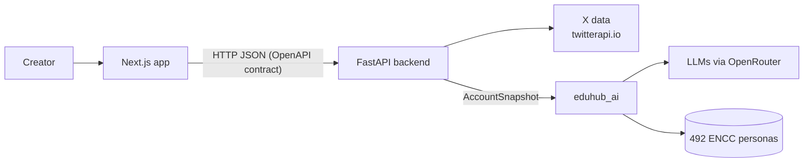

# Nova · your own analyst for X

**Nova explains why a creator's posts work, and tells them what, how and when to post next.**
You enter an `@handle`. In about 20 seconds Nova reads the account's last ~200 posts, finds what works and what doesn't, explains it in plain rioplatense Spanish, and writes three drafts in the creator's own voice. Before you publish, you can test the drafts on a simulated audience built from real Argentine survey respondents.

Built during the **[EDU HU₿ · LABITCONF 2026 hackathon](https://labitconf-hackathon.netlify.app/)** (Creator Economy track), Buenos Aires, 30–31 October 2026.

> **Status: frozen.** This repo is kept as a showcase of what we built during the hackathon. It isn't maintained.

## Demo

<!-- Replace VIDEO_URL with the video link (YouTube, Loom, etc.). -->

[](https://youtu.be/Yyf073GDI0M)

The demo path: **handle → analysis → dashboard → recommendation → drafts → audience simulation.**

## The problem

> _"Los creadores argentinos publican a ciegas: no saben por qué un posteo funciona y otro no, y eso les impide crecer y conseguir acuerdos con marcas."_

Sofi posts every day to land brand deals. One post blows up, the next one dies, and she doesn't know why. She has no team and no analyst, and the existing tools show her charts and write generic posts. None of them tell her why a post worked _for her_.

The hackathon required every solution to be justified with official Argentine data from **[OpenARG](https://openarg.org)**. Here is ours:

| Figure                                                                                               | Source (via OpenARG)                                                    |
| ---------------------------------------------------------------------------------------------------- | ----------------------------------------------------------------------- |
| **11.8 M** Argentines upload their own content to social networks every week, **2.9 M** of them on X | Encuesta Nacional de Consumos Culturales 2022–23, Ministerio de Cultura |
| Jobs in digital content **almost doubled** since 2016, and **9 in 10** are informal                  | Cuenta Satélite de Cultura, INDEC / Ministerio de Cultura               |

Only 1–4% of creators earn a sustainable income. Most of them are micro-creators (1k–100k followers) who would benefit from an analyst but can't afford one.

## What Nova does

|     | Feature                          | What you get                                                                                                                                                                                                                                                                                   |
| --- | -------------------------------- | ---------------------------------------------------------------------------------------------------------------------------------------------------------------------------------------------------------------------------------------------------------------------------------------------- |
| 📊  | **Account analysis**             | KPIs, a day × hour heatmap, performance by topic, format, length and tone, and the top and bottom posts with an explanation of each                                                                                                                                                            |
| 💡  | **Insights and recommendations** | Grounded findings in plain language: _"a la mañana rendís casi el doble que tu posteo típico"_, _"cerrar con un link te resta alcance (0,7x)"_. Every number in the text comes from the analysis.                                                                                              |
| 🎯  | **Creator brief**                | Tell Nova your goal (grow, sell an ebook, drive traffic, build community) and the topics to avoid. Insights and drafts adapt to it.                                                                                                                                                            |
| ✍️  | **Drafts in your voice**         | Three ready-to-post drafts built on your own insights, with a suggested time to publish                                                                                                                                                                                                        |
| 🧪  | **Audience sandbox**             | Run up to three draft variants past a synthetic audience of **492 real ENCC respondents who use X** (representing ~4.7 M people). Each persona reacts and comments, and you see which variant works best, with whom (age, gender, province, socioeconomic level), and who might take it badly. |

Everything the user sees is in Spanish (es-AR). Prices are in pesos.

## Does it work?

We evaluated the engine on **4 real accounts (696 posts)** with posts the model had never seen:

- **64 out of 100:** given two held-out posts, Nova picks the one that performed better 64% of the time (cross-validated, range 56–74% per account). A coin flip gets 50%. Engagement is noisy, so this is a ranking signal, not a prediction of likes.
- **~17 s and ~USD 0.016 per analysis** (median). The full flow (analysis, drafts and a 100-persona simulation) takes ~31 s and costs ~USD 0.04.
- **End to end:** 8 of 8 runs through the real HTTP API passed, with 132 LLM calls and 0 failures.

Details: [`src/ai/docs/results/2026-10-31-e2e/`](src/ai/docs/results/2026-10-31-e2e/README.md) and [`src/ai/docs/plan/10-evaluation-demo-hardening.md`](src/ai/docs/plan/10-evaluation-demo-hardening.md).

## How it works



The AI engine is a **hybrid of statistics and LLMs**:

1. **Deterministic features** for each post: length, hour and weekday in Argentina time, media, links, hashtags, questions, emojis, thread or reply.
2. **Semantic labels** from an LLM: topic, tone, sentiment, hook and call to action.
3. **A stats engine** that compares each post to the account's own median (a score of 1.0 is a typical post) and computes segments with bootstrap confidence intervals and significance tests.
4. **A ridge regression pattern model** per account that separates the effect of each factor ("all else being equal").
5. **An insight writer** that turns the evidence into Spanish texts, plus a **grounding check** that rejects any number that isn't in the evidence. Template texts take over if the LLM fails.
6. **A draft generator and an audience simulator** that build on the same insights.

The AI never fetches data itself: it only receives an `AccountSnapshot`, so new platforms (Instagram, TikTok, YouTube) can plug into the same engine.

**Stack:** Python 3.14 · FastAPI · Pydantic v2 · SQLite · Next.js 16 · React 19 · Tailwind · shadcn/ui · Recharts · TanStack Query · OpenRouter (DeepSeek) · twitterapi.io · Render.

## How we built it: 3 teams in parallel, with contracts

Five people in three teams (frontend, backend, AI), working at the same time during the hackathon, each with Claude Code. To keep the teams from blocking each other, we started with **contracts** in [`src/shared/`](src/shared/):

- **Pydantic models** as the single source of truth, with the **OpenAPI spec** generated from them. The frontend generated its TypeScript types from it.
- **Python interfaces** between the backend and the AI (`create_analyzer`, `create_generator`, `create_simulator`).
- **Fixtures and fakes** for every interface, so the frontend could mock the API and the backend could run the whole pipeline before the AI was ready.

**Guardrails** for humans and for Claude:

- Git and Claude Code hooks enforce folder ownership.
- Tests are frozen once a human approves them (TDD).
- Any contract change needs a version bump and a changelog entry, and the other teams get an alert.

The rules are in [`CLAUDE.md`](CLAUDE.md) and [`docs/workflow.md`](docs/workflow.md).

## Repo layout

| Path                             | What                                                                                      |
| -------------------------------- | ----------------------------------------------------------------------------------------- |
| [`src/frontend/`](src/frontend/) | Next.js app: landing, analysis progress, dashboard, drafts, sandbox                       |
| [`src/backend/`](src/backend/)   | FastAPI service: data sources, analysis jobs, API, publishing, deployment                 |
| [`src/ai/`](src/ai/)             | `eduhub_ai`: features, labeling, stats, pattern model, insights, drafts, audience sandbox |
| [`src/shared/`](src/shared/)     | Contracts: models, interfaces, `openapi.json`, metric formulas, fixtures, fakes           |
| [`docs/`](docs/README.md)        | Product, OpenARG evidence and validation, architecture, workflow, pitch                   |
| [`scripts/`](scripts/)           | Repo tooling: style, contract and frozen-test checks                                      |

Good places to start: [`docs/product.md`](docs/product.md) (what and why), [`docs/validation.md`](docs/validation.md) (all the evidence), [`docs/architecture.md`](docs/architecture.md) (system design).

## Run it locally

```bash
git clone https://github.com/JuaniLlaberia/eduhub-hackathon.git && cd eduhub-hackathon

# Backend + AI (Python 3.14)
python3.14 -m venv .venv && source .venv/bin/activate
pip install -r requirements-dev.txt
cp .env.example .env        # add OPENROUTER_API_KEY; TWITTERAPI_IO_KEY for live X data
uvicorn eduhub_backend.app:main --factory --reload

# Frontend (Node 20+), in another terminal
cd src/frontend && npm install
echo "NEXT_PUBLIC_API_URL=http://localhost:8000" > .env.local
npm run dev                 # http://localhost:3000
```

- **No keys?** Set `EDUHUB_FAKE_AI=1` and `DEMO_MODE=1` in `.env` to serve the pre-computed demo reports, or run the frontend alone with `NEXT_PUBLIC_API_MOCK=1`.
- **Tests:** `pytest src/shared src/backend src/ai` and `cd src/frontend && npm run check`.

Thanks to the EDU HU₿ and LABITCONF staff and mentors, and to OpenARG for open access to Argentine public data.
