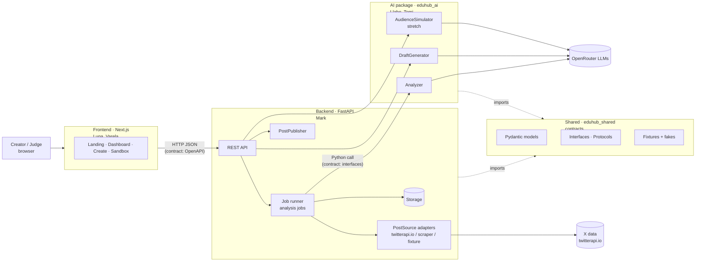
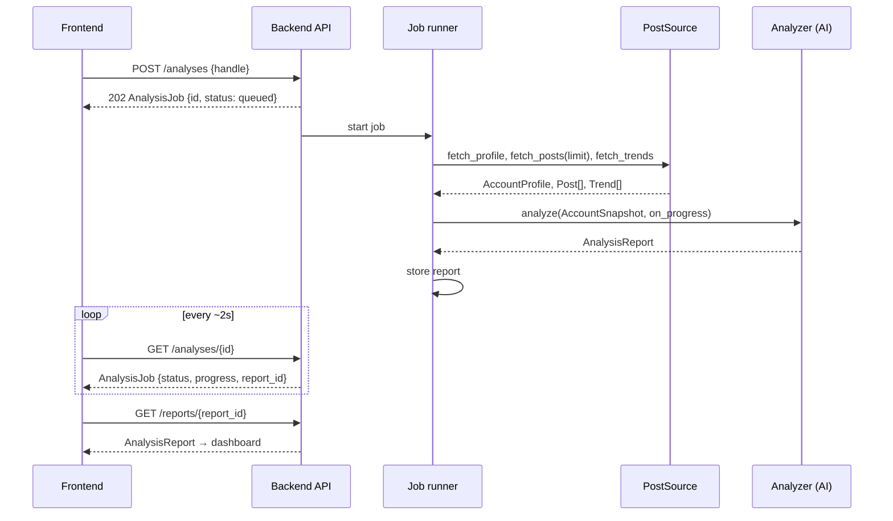

# Architecture

> Status: **approved 2026-10-30, contract v1.0.0.** Changes follow [workflow.md](workflow.md) §3. The exact fields are in `src/shared/eduhub_shared/models/`.

## 1. Overview



- **One deployable Python service** (backend + AI as an imported package) plus **one Next.js app**. That's the simplest setup to deploy and demo in 8 hours.
- The AI package **never fetches X data and never knows its source**. It receives an `AccountSnapshot` (the data contract).
- The frontend **only talks to the backend API**. It never calls the AI or X directly.

## 2. Ownership

| Path | Owner | Others may |
|---|---|---|
| `src/frontend/` | Front (Lupa, Varela) | read |
| `src/backend/` | Back (Mark) | read |
| `src/ai/` | AI (Llabe, Tomi) | read |
| `src/shared/` | **Everyone, via the contract change process only** | propose changes |
| `docs/teams/<team>.md` | That team | read, comment |
| `docs/*.md`, root files | Everyone, after agreement | — |

Enforced by Claude Code hooks and git hooks (see [workflow.md](workflow.md)).

## 3. Repo layout

```
/
├── CLAUDE.md                  # rules for every Claude session (all teams)
├── docs/                      # product, validation, architecture, workflow, team docs
├── scripts/                   # repo tooling (contract checks, test approval, validation)
├── .claude/                   # shared Claude Code settings + hooks
├── .githooks/                 # git hooks (contract + approved-tests checks)
├── pyproject.toml             # tooling config (ruff, pytest); requirements-dev.txt installs the 3 packages
└── src/
    ├── shared/                # CONTRACTS: models, interfaces, OpenAPI, fixtures, fakes
    │   ├── eduhub_shared/
    │   ├── contracts/openapi.json   # generated from models + routes; front uses it
    │   ├── eduhub_shared/version.py # CONTRACT_VERSION
    │   └── CHANGELOG.md
    ├── backend/               # FastAPI app (internal structure: back team decides)
    ├── ai/                    # eduhub_ai package (internal structure: AI team decides)
    └── frontend/              # Next.js app
```

Python 3.14: one virtualenv (`.venv`) with three editable packages (`eduhub-shared`, `eduhub-backend`, `eduhub-ai`) installed by `requirements-dev.txt`. Each team owns its own `pyproject.toml` and dependencies.

## 4. Contracts (what lets the teams work in parallel)

| # | Contract | Between | Form | Location |
|---|---|---|---|---|
| C1 | **Domain models** | all | Pydantic v2 models (single source of truth) | `src/shared/eduhub_shared/models/` |
| C2 | **Data source interface** | backend internal + AI input | `PostSource` Protocol and `AccountSnapshot` model | `src/shared/eduhub_shared/interfaces.py` |
| C3 | **AI interfaces** | back ↔ AI | `Analyzer`, `DraftGenerator`, `AudienceSimulator` Protocols + factory functions exported by `eduhub_ai` | `interfaces.py` |
| C4 | **HTTP API** | front ↔ back | OpenAPI 3.1, generated from C1 + a route table; the front generates TS types from it | `src/shared/contracts/openapi.json` |
| C5 | **Metric formulas** | all | Pure functions + tests | `src/shared/eduhub_shared/metrics.py` |
| C6 | **Fixtures and fakes** | all | Example JSON for each model, plus fake implementations of every interface | `src/shared/eduhub_shared/fixtures/`, `fakes.py` |

**What C6 gives each team:**
- **Front** mocks the API with the JSON fixtures on day one.
- **Back** builds the whole pipeline with `FakeAnalyzer` before the AI is ready.
- **AI** develops against fixture snapshots without needing X access.

A contract test checks that the committed `openapi.json` and fixtures always match the models.

## 5. Domain model (summary; exact fields defined in C1)

```
Platform = "x"  (future: "instagram" | "tiktok" | "youtube")

AccountProfile   platform, handle, display_name, bio, followers_count, following_count, posts_count, verified, avatar_url, created_at
Post             id, platform, author_handle, text, created_at (UTC), url, lang, kind (original|reply|quote|repost), media[], has_link, hashtags[], mentions[], metrics: PostMetrics
PostMetrics      impressions?, likes, reposts, quotes, replies, bookmarks, [optional private: detail_expands?, profile_clicks?, link_clicks?]
Trend            name, rank, post_count?, location, observed_at
AccountSnapshot  profile, posts[], trends[], source (e.g. "twitterapi.io", "fixture"), collected_at      ← AI input

PostRates        engagement_rate, save_rate, share_rate, reply_rate, like_rate, passive_rate   (C5 formulas)
PostFeatures     char_count, word_count, hour_local, weekday, media_type, has_link, hashtag_count, mention_count, is_question, has_emoji, topic, tone, sentiment, matches_trend
AnalyzedPost     post + features + rates + score (relative to the account median)
AccountKPIs      post_count, period_start/end, posts_per_week, avg/median impressions, mean rates
TimeSlotStat     weekday, hour, post_count, avg_score                       ← heatmap
SegmentStat      dimension (topic|media_type|length_bucket|tone), value, post_count, avg_score, avg_engagement_rate
Insight          id, category, title, description (es-AR), evidence[], impact (high|medium|low), confidence, related_post_ids[]
Recommendation   id, category, action (es-AR), rationale, priority, based_on_insight_ids[]
AnalysisReport   id, profile, generated_at, kpis, posts[AnalyzedPost], heatmap[], segments[], best_time_slots[], insights[], recommendations[], summary (es-AR)   ← AI output

DraftRequest     handle, topic?, recommendation_id?, instructions?, count (1–5)
Draft            id, text, rationale, suggested_time, estimated_score?, based_on_insight_ids[]
PublishRequest   handle, text, scheduled_for?        PublishResult  status (published|scheduled|failed), post_id?, url?, error?
Persona          id, age_group, gender, province, socioeconomic_level, platforms[], traits, weight          (stretch)
SimulationRequest text variants[], audience_size, filters        SimulationResult  per-variant reactions, by-segment rates, summary
AnalysisJob      id, handle, status (queued|fetching|analyzing|done|failed), progress 0–1, error?, report_id?
```

## 6. System flows

### 6.1 Analysis (MUST)



The job is async because it fetches about 200 posts and makes LLM calls, which can take 30 seconds to 2 minutes. The front polls, so no websockets are needed.

### 6.2 Draft generation (WANTED)

`POST /drafts {handle, recommendation_id | topic}` → the backend loads the latest report for that handle and current trends → `DraftGenerator.generate(request, report, trends)` → `Draft[]`. This call is synchronous and takes about 5–15 seconds.

### 6.3 Publishing (WANTED)

`POST /publications {handle, text, scheduled_for?}` → `PostPublisher` (backend) → `PublishResult`. Needs write access to X; open question for the back team.

### 6.4 Sandbox (STRETCH)

`POST /simulations {variants[], audience_size, filters}` → `AudienceSimulator.simulate` → `SimulationResult`. The AI team builds personas from ENCC microdata (OpenARG).

### 6.5 Feature flags

`GET /features` → `{generation, publishing, simulation}` as booleans. The front hides whatever is disabled, so WANTED and STRETCH features can be switched off without breaking the demo.

## 7. HTTP API (draft; final version in C4)

| Method | Path | Body → Response | Priority |
|---|---|---|---|
| GET | `/health` | → `{status}` | MUST |
| GET | `/features` | → `FeatureFlags` | MUST |
| POST | `/analyses` | `{handle, max_posts?}` → 202 `AnalysisJob` | MUST |
| GET | `/analyses/{job_id}` | → `AnalysisJob` | MUST |
| GET | `/reports/{report_id}` | → `AnalysisReport` | MUST |
| GET | `/accounts/{handle}/report` | → latest `AnalysisReport` (404 if none) | MUST |
| GET | `/trends` | → `Trend[]` (Argentina, current) | nice |
| POST | `/drafts` | `DraftRequest` → `Draft[]` | WANTED |
| POST | `/publications` | `PublishRequest` → `PublishResult` | WANTED |
| POST | `/simulations` | `SimulationRequest` → `SimulationResult` | STRETCH |

- Errors: `{"error": {"code": "...", "message": "..."}}` with standard HTTP status codes.
- JSON uses snake_case.
- Datetimes are ISO 8601 in UTC. The UI shows them in `America/Argentina/Buenos_Aires`.

## 8. Cross-cutting conventions

- **Language:** user-facing text produced by the AI (insights, recommendations, summary, drafts) is in **Spanish (es-AR)**. Code, contracts and docs are in English.
- **Time:** stored in UTC. Local features (hour, weekday) use `America/Argentina/Buenos_Aires`.
- **Handles:** stored without `@`, lowercase.
- **Secrets:** only in environment variables (`.env`, never committed): `TWITTERAPI_IO_KEY`, `OPENROUTER_API_KEY`, and others.

## 9. Deployment (suggestion; the back team decides)

- Front on **Vercel**. The Python service on **Railway / Render / Fly.io** (Docker).
- Storage: SQLite to start, or Supabase/Postgres if needed.
- `NEXT_PUBLIC_API_URL` points the front to the backend.
- **Demo safety:** the backend can serve **pre-computed reports** for the demo account(s) (`DEMO_MODE`), and a `FixturePostSource` replays a saved snapshot. **The live demo must work even if X or the LLM provider fails.**
- Heavy ML dependencies (e.g. torch) slow down builds and deploys. The AI team should keep the runtime light or pre-compute.

## 10. Open questions per team

See [teams/frontend.md](teams/frontend.md), [teams/backend.md](teams/backend.md) and [teams/ai.md](teams/ai.md).
